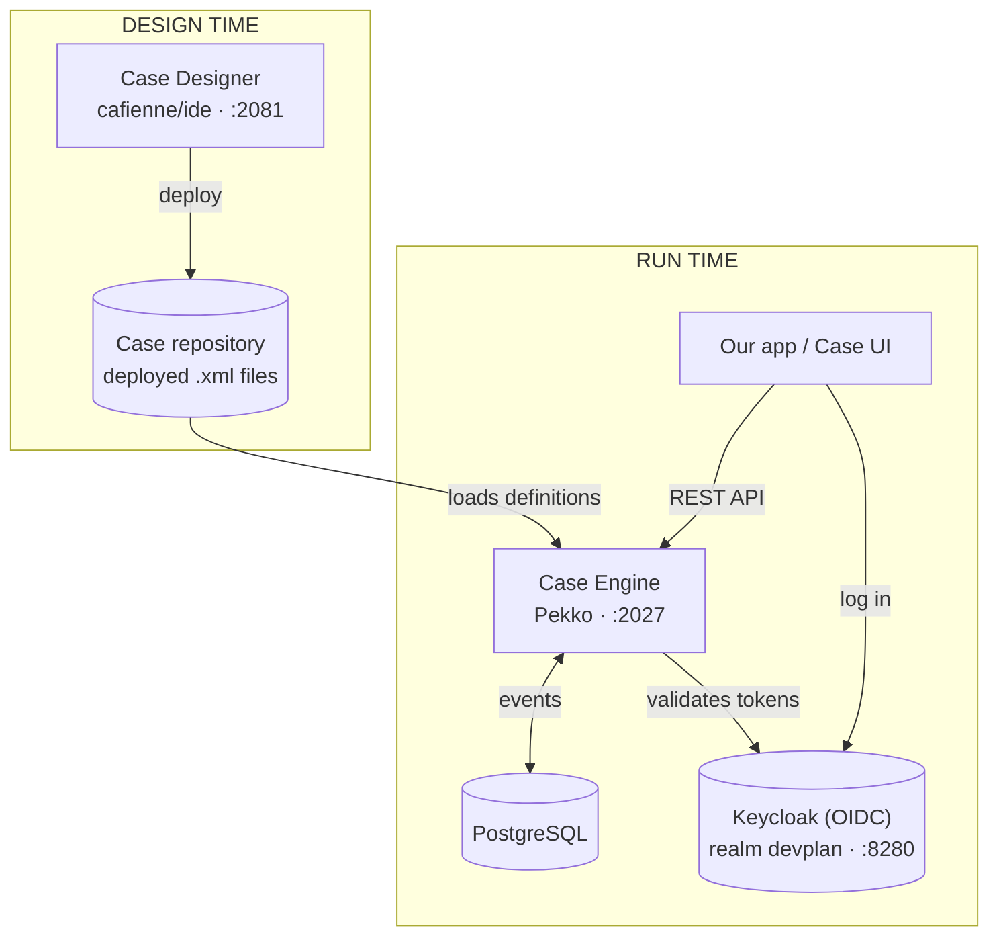
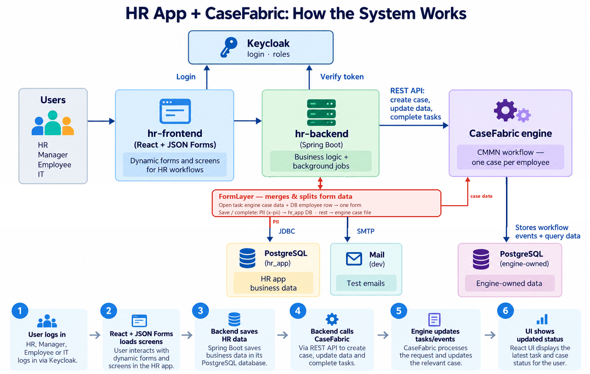
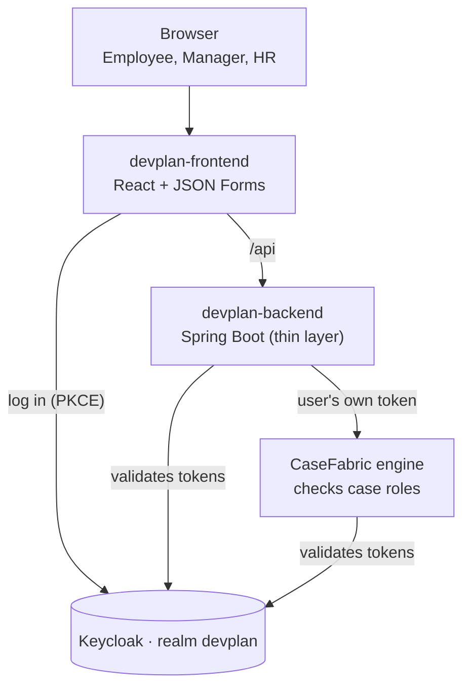
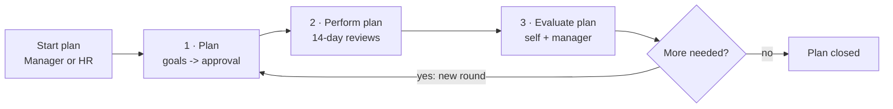

# CaseFabric Training Guide for New Team Members

## 1. About this guide

This guide gets a new team member productive with CaseFabric in their first week. It explains the tool in simple words, shows how our app uses it, and walks through our own case model.

You should already know basic Java/Spring Boot, React, REST APIs and Docker. You do not need any prior knowledge of case management or CMMN.

After reading this guide you will be able to:
- Explain what CaseFabric is and when to use a case instead of a fixed workflow
- Read a `.case` file and recognise stages, tasks, milestones, sentries and case file items
- Deploy a case, start it, and complete a task, both in the UI and through the REST API
- Explain how our React app and Spring Boot backend talk to the CaseFabric engine
- Describe our Development plan case and what is still being decided

**This edition adds two things on top of the plain reference material**: short **"See it in our onboarding PoC"** boxes next to each CMMN concept as it's introduced, pointing at the real `0 · Onboarding` stage inside `development.case` (the most complete, UI-rich example in our codebase), and one dedicated walkthrough (Section 8.4) that steps through the whole onboarding flow screen by screen, pairing each app screen with the Designer view behind it. Visuals are numbered **Screenshot 1, 2, 3, …** sequentially through the whole document. Most are placeholders pending capture — drop the real image in at `docs/screenshots/screenshot-<NN>-<slug>.png` and reference it from here when you capture it. A few screenshots already exist and are embedded directly (e.g. Screenshot 7).

### Suggested first-week plan
1. **Day 1**: Read sections 2 and 3 (what CaseFabric is, key terms).
2. **Day 2**: Start the local stack (section 6) and click through a case in the Case UI.
3. **Day 3**: Read sections 4, 5 and 7 (architecture, modeling, our integration).
4. **Day 4**: Read section 8 with the case diagram **and the onboarding walkthrough (8.4) open side by side**.
5. **Day 5**: Do the exercises in section 9 and bring your questions to the team.

---

## 2. What is CaseFabric?

CaseFabric is a platform for dynamic case management. You draw a case model in a browser tool, and the engine runs that model directly. There is no code generation step: the model *is* the running application logic.

It is built on two open standards from the OMG (Object Management Group):
- **CMMN** (Case Management Model and Notation) describes cases: stages, tasks, milestones and the rules between them. CaseFabric implements CMMN 1.1.
- **DMN** (Decision Model and Notation) describes business decisions as decision tables.

The engine underneath is the open-source **Cafienne** engine. That is why our Docker images are named `cafienne/...` and our case XML uses the `org.cafienne` namespace. Treat "CaseFabric" and "Cafienne" as the same product for day-to-day work.

### Case vs. fixed workflow

A traditional workflow (BPM/BPMN) is a flowchart: step 1, then step 2, then step 3. It works well for routine, predictable work such as invoice approval.

A **case** is goal-driven instead of path-driven. It suits work where the order of steps is not known in advance and people use their own judgment. Steps can repeat, be skipped, or be added on the fly.

|  | Fixed workflow (BPMN) | Case (CMMN) |
|---|---|---|
| Driven by | A fixed path | A goal |
| Order of steps | Decided up front | Decided as the case runs |
| Ad-hoc work | Hard to add | Built in (discretionary tasks) |
| Best for | Routine, repeatable work | Knowledge work, exceptions, judgment |
| Example | Invoice approval | Insurance claim, employee development |

### Why we use it

An employee's development is not a straight line. A plan can be sent back for changes many times. Progress reviews repeat every 14 days or whenever a manager asks. Employees and managers can add new activities at any time. A flowchart would get messy fast; a CMMN case handles this naturally.

---

## 3. Key terms

These are the words you will hear every day. Examples come from our own `development.case`.

### The case itself

| Term | Simple meaning | Example in our case |
|---|---|---|
| Case | A goal-driven piece of work. It has three parts: a Case File (data), a Case Plan (behaviour) and a Case Team (people). | One `development` case per employee |
| Case Definition | The deployed blueprint of a case (its CMMN XML file). | `development.xml` |
| Case Instance | One running copy of a case definition. | The case for employee Alice, with its own ID |
| Case Plan Model | The outer box of the case that holds everything else. | "Development", with `autoComplete="false"` so it runs for the whole employment |
| Plan Item | Anything placed in the plan: a stage, task, milestone or event listener. | "Define goals & plan", "Plan approved" |
| Plan Item Definition | The reusable description behind a plan item (what it does, its inputs and outputs). The Designer hides this split; the XML shows it. | `pi_define_plan` points to definition `define_plan` |
| Stage | A container that groups plan items. Stages can be nested. | "1 · Plan", "2 · Perform plan", "3 · Evaluate plan" |

> **See it in our onboarding PoC:** The `0 · Onboarding` stage (`<stage id="pi_onboarding" name="0 · Onboarding">`) is a real Stage inside the same `development.case` Case Plan Model used for the development-plan cycle — not a separate case (see Section 8.1's repo-reality note). It starts when the case-file item `Onboarding` is created and ends when the `Employee onboarded` milestone occurs.
>
> **Screenshot 1 — The "0 · Onboarding" stage on the canvas**
> *Source:* Case Designer, `development.case`, stage `pi_onboarding`.
> Shows the stage box with its entry sentry (on-part: case file item `Onboarding` → `create`) and exit sentry (on-part: milestone `pi_employee_onboarded` → `occur`) as diamond connectors on the stage boundary.

### Tasks

| Term | Simple meaning | Example in our case |
|---|---|---|
| Task | One unit of work. There are four kinds below. |  |
| Human Task | Work a person does by filling in a form. It has a performer role and a task model (the form). | "Approve plan", done by the Manager |
| Process Task | Calls an external service or system, usually over HTTP. | "Notify IT" calls our backend's mail endpoint |
| Case Task | Starts another case, standalone or as a child. | Not used yet; may be needed after the case split |
| Decision Task | Runs a DMN decision. | Not used |

> **See it in our onboarding PoC:** the onboarding stage has a Human Task and a Process Task side by side: HR fills in the "Equipment request by HR" form (a Human Task, `pi_it_request`, `performerRef="cr_dv_HR"`), and when it completes, "Notify IT" (`pi_mail_it_request`) silently calls out to send the IT-notification e-mail — no screen for that one at all. We have **no Case Task example** anywhere in this repo yet, so don't go looking for one.
>
> **Screenshot 2 — The "Notify IT" process task and its HTTP call**
> *Source:* Case Designer, `development.case`, process task `pi_mail_it_request` → `dv_mail_it_request.process`.
> Shows the process task box plus its implementation panel (`HTTPCallDefinition`: URL, method, POST body, headers) — a good side-by-side contrast with a Human Task's Properties panel.

### Milestones and events

| Term | Simple meaning | Example in our case |
|---|---|---|
| Milestone | A target that has been reached. It has no form; it just marks that something is true. | "Plan approved", "Plan closed" |
| Event Listener | Waits for something to happen. Two kinds below. |  |
| Timer Event Listener | Fires after a period of time (ISO-8601 duration, e.g. `P14D` = 14 days). | "Progress check due" after 14 days |
| User Event Listener | A button an authorised person can press. | "Start development plan" (Manager or HR) |

> **See it in our onboarding PoC:** the milestone `pi_employee_onboarded` ("Employee onboarded") and the user event `pi_complete_onboarding` ("Complete onboarding", `authorizedRoleRefs="cr_dv_HR"`) work together: HR pressing the button is the User Event; combined with `Onboarding.mandatoryItemsDone == true`, it is what actually makes the milestone occur. This is a good first example of a milestone with a *compound* entry condition — see Section 8.4, step 9 for the full breakdown. There is no onboarding-specific Timer Event Listener example; the Development-plan cycle's 14-day "Progress check due" timer (Section 8.5) is the one to look at for that.
>
> **Screenshot 3 — "Employee onboarded" milestone's entry criterion panel**
> *Source:* Case Designer, `development.case`, milestone `pi_employee_onboarded`.
> Shows both halves of its compound entry criterion together: an If-Part (`Onboarding?.mandatoryItemsDone == true`) and an On-Part (`pi_complete_onboarding` → `occur`).

### Sentries (the "if this, then that" rules)

| Term | Simple meaning | Example in our case |
|---|---|---|
| Sentry | A guard that watches for an event and/or a condition. |  |
| Entry Criterion | A sentry that decides when a plan item can start. Several entry criteria on one item mean OR. | "Review progress" starts on the 14-day timer OR an early review request |
| Exit Criterion | A sentry that stops a plan item early. | "2 · Perform plan" exits when "Plan performed" happens |
| On-Part | The "when" part: watches another item's change, like `complete` or `occur`. | When "Approve plan" completes |
| If-Part | The "only if" part: a condition on case data, written in SpEL. | `Approval?.decision == 'REJECTED'` |

> **See it in our onboarding PoC:** the best sentry example in the whole repo lives here. When "Equipment request by HR" (`pi_it_request`) completes, **two separate plan items** react to the exact same event — the process task "Notify IT" and the human task "Equipment approval by IT" — through two different entry criteria (`ec_mail_it_request_0` and `ec_equipment_request_0`) that both watch the same `planItemOnPart sourceRef="pi_it_request"` → `complete`. One event, two listeners — a cleaner "fan-out" example than anything on the development-plan-cycle side. (The milestone's compound sentry shown in Screenshot 3 above is the complementary "If-Part + On-Part together" pattern.)
>
> **Screenshot 4 — One completion, two listeners (fan-out sentry pair)**
> *Source:* Case Designer, `development.case`, the two entry criteria leaving "Equipment request by HR."
> Shows two arrows leaving the same task box, each ending at a different entry-sentry diamond on "Notify IT" and "Equipment approval by IT."

### Data: the case file

| Term | Simple meaning | Example in our case |
|---|---|---|
| Case File | The JSON data of one case. Everyone on the case team can see it. | Holds Employee, Plan, Approval, Activities and more |
| Case File Item | One piece of that data, with a type and a multiplicity. `ZeroOrMore` makes it a list. | `Activities` is a list |
| Discretionary Item | Optional work that a user can add when they want. Only stages, human tasks and case tasks can be discretionary. | "Training and learning", "Coaching and mentoring" |
| Planning Table | The container that holds discretionary items, with optional rules on when they can be added. | `pt_perform` in "2 · Perform plan" |
| Input Mapping | How case file data goes into a task. | "Review progress" reads the Activities list |
| Output Mapping | How a task's result is written back. `replace` overwrites, otherwise data is merged. | "Define goals & plan" replaces the Plan |
| Case Parameters | Inputs given when a case starts. | `Employee` (employeeId, managerId, trigger) |

> **See it in our onboarding PoC:** the `Onboarding` case file item (type `dv_onboarding.type`) is the richest case-file example in this guide — `status`, `itStatus`, `itRequestSent`, `mandatoryItemsDone`, `completed`, a nested `ITRequest` object, and two lists (`Assets[]`, `Checklist[]`). Notice there is no e-mail address or username field anywhere in it — `dv_onboarding.type` says so directly in its own code comment: *"No e-mail addresses or usernames here: the mail process tasks trigger the devplan backend with just `Employee.employeeId`, and the backend resolves real recipient addresses from the employee directory (DB) at send time."* That's the "keep PII out of the case file" rule from Section 8.7, already in force today.
>
> **Screenshot 5 — The `Onboarding` case file item's schema**
> *Source:* Case Designer, Case File Model editor, `dv_onboarding.type`.
> Shows the full property tree, including the nested `ITRequest` object and the `Assets`/`Checklist` lists — nearly every onboarding screen reads or writes this one item.

### Rules on plan items

| Rule | What it does | Default |
|---|---|---|
| Required | The parent stage cannot complete until this item is done. | Not required |
| Repetition | The item can run again; each run is a new instance. | Not repeatable |
| Manual Activation | Whether a ready item must be started by hand or starts by itself. | Manual |

> **See it in our onboarding PoC:** interestingly, the onboarding stage barely uses these rules at all — every step happens once, in a fixed order, driven entirely by sentries rather than Repetition or Manual Activation. If you want a real Repetition example, look at the Development-plan-cycle's repeating stages instead (Section 8.5, e.g. `pi_development_plan`, `pi_plan`, `pi_perform` all repeat). Onboarding is a useful *contrast* case: not every concept needs to show up everywhere.

### People and security

| Term | Simple meaning | Example in our case |
|---|---|---|
| Case Role | A role inside one case that controls who can do tasks, add discretionary items and raise user events. | Employee, Manager, HR, ITAdmin |
| Case Team | The people on a case and their case roles. A member can be a single user or a whole tenant role. | Employee and Manager by user ID; everyone with tenant role HR |
| Tenant | An isolated space for cases and users. Every case starts inside a tenant. | `devplan` |
| Tenant Owner | A user who manages a tenant and can deploy case definitions. | `sridhar_hr`, `devplan-backend` service account |

> **See it in our onboarding PoC:** this is the one part of the whole case where all four roles do something within a few steps of each other — HR runs steps 1–2 and 8, IT Admin runs steps 5–6, the new joiner only sees their own dashboard (step 7), and the Manager is added to the case team at step 1 even though they don't act again until the development-plan cycle starts. A good quick reference for "who does what." Full detail: Section 8.4.
>
> **Screenshot 6 — Case Roles / Case Team editor**
> *Source:* Case Designer, `development.caseteam`.
> Shows all four roles (`cr_dv_Employee`, `cr_dv_Manager`, `cr_dv_HR`, `cr_dv_ITAdmin`) in one view.

### Runtime terms

| Term | Simple meaning |
|---|---|
| Plan item states | Available, Enabled, Active, Completed, plus Disabled, Failed, Suspended, Terminated. Entry criteria are checked while Available; exit criteria while Active. |
| SpEL | Spring Expression Language, used for conditions and mappings. `?.` means "skip if empty". |
| Event Journal | Every event in every case is stored here. This is the full history (audit trail). |
| Query Database | Read-friendly copies (projections) of cases and tasks, built from the journal. |
| Pekko | The actor framework the engine runs on. Each case runs as its own independent actor. |

(No onboarding-specific example here — these are infrastructure concepts already covered by the architecture callout in Section 4 and the SpEL callout in Section 5.4.)

---

## 4. How CaseFabric works

CaseFabric has a designer for building models, an engine that runs them, and a REST API that every UI uses. The engine does no login itself; it trusts tokens from an OpenID Connect identity provider.

| Component | What it does | Our container | Local port |
|---|---|---|---|
| Case Designer (IDE) | Browser tool to draw CMMN models, case file types, roles and task forms | `cafienne/ide` | 2081 |
| Case Engine | Runs the models: tracks what is done, what is active and what can happen next | `cafienne/engine:1.1.35` | 2027 |
| REST API | Part of the engine. Groups: `/repository`, `/cases`, `/tasks`, `/tenant`, `/platform` | (engine) | 2027 (Swagger UI) |
| Generic Case UI | A ready-made UI that can show any case and render its task forms. Great for learning and testing. | `cafienne/cafienne-ui:0.7.3` | 3317 |
| Engine database | Event Journal (full history) and Query Database (read views), both in PostgreSQL | `case-engine-db-postgres` | 5431 |
| Identity provider | Issues login tokens. The demo uses Dex; we use Keycloak. | `keycloak` | 8280 |

**Design time vs run time.** At design time you build a model in the Designer and deploy it to the engine's repository. At run time, users start cases and complete tasks through a UI, which calls the engine's REST API with the user's token. The engine loads definitions from the repository and stores every event in the database.


*CaseFabric architecture · design time and run time.* Every UI goes through the engine's REST API; the engine checks each token with Keycloak and writes every event to PostgreSQL.

> **See it in our onboarding PoC:** every time HR clicks "Send to IT" in the onboarding wizard, the browser's call goes exactly through this path: our frontend → our backend (`/api/onboarding/...`) → CaseFabric engine REST API (`PUT /tasks/{id}/complete`) → event written to PostgreSQL. Section 8.4 traces this exact click end to end.
>
> **Screenshot 7 — HR App + CaseFabric system overview** *(real image, already captured)*
>
> 
>
> *Source:* `docs/hr-app-system-overview.png`. Note: this particular diagram labels the two tiers "hr-frontend"/"hr-backend"; the actual Docker container names (and the names used in the rest of this guide) are `devplan-frontend`/`devplan-backend` — same components, different label in this one image.

---

## 5. Building a case in the Case Designer

A case is built in nine steps: create, add items, add data, connect with sentries, set rules, add roles, build forms, validate, deploy.

### 5.1 Step by step
1. **Create a new case.** You get an empty Case Plan Model and an empty Case File panel.
2. **Drag items from the ShapeBox** onto the canvas: Stage, Human Task, Process Task, Case Task, Milestone, Timer or User Event Listener. The editor warns you if a drop is not valid CMMN.
3. **Reuse existing items** by dragging them from the Repository Browser. A case becomes a Case Task, a process becomes a Process Task, a task becomes a Human Task.
4. **Add Case File Items.** Add properties with a name and data type, and nest them as needed.
5. **Connect items with sentries.** Drag an entry or exit sentry from one item to another. Set the On-Part (which item, which event) and, if needed, the If-Part (a SpEL condition).

   > **See it in our onboarding PoC:** we already showed this exact pattern in Section 3's "Sentries" callout (Screenshot 4) — here's where it lives in the *build* workflow instead of the glossary.

6. **Set rules** (Required, Repeat, Manual Activation) in each item's Properties panel.
7. **Add roles** with "Add Roles" in the toolbar. Set the performer on each human task and the authorised roles on user events and discretionary items.
8. **Build each task form** with "Human Task Model → Create+Open". Click *Generate schema from type information* for a starting point, then edit.

   > **See it in our onboarding PoC:** compare 5.2's "Define goals & plan" task model below with `dv_equipment_request_hr.humantask` ("Equipment request by HR") — it uses a JSONForms `Group` layout with two groups ("Laptop & hardware", "Accounts & software") instead of a plain `VerticalLayout`, a good second example once you're comfortable with 5.2's.
   >
   > **Screenshot 8 — `dv_equipment_request_hr.humantask`'s Human Task Model editor**
   > *Source:* Case Designer, Human Task Model editor for `dv_equipment_request_hr.humantask`.
   > Shows the `Group`-based `uiSchema` and `submitLabel: "Send to IT"`.

9. **Validate, then deploy.** Validate asks the engine to check the model. In our project we deploy with `deploy-case.py` (see section 6).

### 5.2 Human task forms (task models)

Every human task needs three things: **who** does it (performer role), **what data** goes in and out (input/output mappings), and **what form** the user sees (the task model).

The task model is JSON with three parts:
- `schema`: a JSON Schema that defines the fields
- `uiSchema`: the layout (we mostly use JSON Forms layouts)
- `submitLabel`: the text on the submit button

A shortened version of our real "Define goals & plan" form:

```json
{
  "schema": {
    "title": "Define goals & plan",
    "type": "object",
    "required": ["Plan"],
    "properties": {
      "Plan": {
        "type": "object",
        "properties": {
          "period": { "type": "string", "title": "Plan period" },
          "goals": {
            "type": "array",
            "minItems": 1,
            "items": {
              "type": "object",
              "properties": {
                "title": { "type": "string", "title": "Goal" },
                "type": { "type": "string", "enum": ["SKILL", "KNOWLEDGE", "BEHAVIOUR", "CAREER"] },
                "targetDate": { "type": "string", "format": "date" }
              }
            }
          }
        }
      }
    }
  },
  "uiSchema": {
    "type": "VerticalLayout",
    "elements": [
      { "type": "Control", "scope": "#/properties/Plan/properties/period" },
      { "type": "Control", "scope": "#/properties/Plan/properties/goals" }
    ]
  },
  "submitLabel": "Send for approval"
}
```

Things to remember:
- The engine only saves top-level fields whose names match a declared **output** of the task (here `Plan`). Other fields are ignored.
- Keys starting with `x-` (like `x-on-complete`, `x-pii`, `x-options`) are **our own app conventions**, read by our backend. The engine and the generic Case UI ignore them.

> **Careful — not every task form matches its `.humantask` file.** Open `dv_employee_details.humantask` in the Designer and you'll see only a generic `Details` placeholder (marked `"x-pii": "employee"`) plus, as of this edition, a small real `Comments` field for HR notes. But the real "Employee details" form HR actually fills in has many more personal-detail fields, with real labels and different required-ness. Those come from the `employee` database table's columns, merged in at runtime by our backend's form layer (`forms/TableStore.java`, migration `V13__employee_details_schema_from_db.sql`) — the `.humantask` file's `Details` object is intentionally a stub. This is the one place in our whole model where "read the task-model XML to know the form" breaks down. Full explanation and both screenshots: Section 8.4, step 2.

### 5.3 A real example: the "1 · Plan" stage

This is how a plan gets written, approved or sent back:
1. The stage starts when someone presses "Start development plan", **or** when a previous round's evaluation says more development is needed.
2. The Employee does "Define goals & plan".
3. When that completes, the Manager does "Approve plan".
4. If the decision is `REJECTED`, "Revise plan" opens for the Employee. When it completes, "Approve plan" opens again. This can loop any number of times.
5. If the decision is `APPROVED`, the milestone "Plan approved" is reached.
6. Because "Plan approved" is Required, the stage cannot finish until approval happens.

The key XML, shortened:

```xml
<milestone id="pi_plan_approved" name="Plan approved">
  <entryCriterion>
    <ifPart contextRef="Approval">
      <condition><body>Approval?.decision == 'APPROVED'</body></condition>
    </ifPart>
    <planItemOnPart sourceRef="pi_approve_plan">
      <standardEvent>complete</standardEvent>
    </planItemOnPart>
  </entryCriterion>
  <itemControl>
    <requiredRule><condition><body>true</body></condition></requiredRule>
  </itemControl>
</milestone>
```

Read it as: *when "Approve plan" completes, and only if the decision is APPROVED, reach this milestone.*

Section 8.4 walks through a second, fuller worked example — the onboarding stage — end to end, including parts this one doesn't show (a fan-out sentry, a process task, a user event with `authorizedRoleRefs`). Read that section once you're comfortable with this one.

### 5.4 Useful SpEL patterns

| Goal | Expression |
|---|---|
| Compare a value | `Approval?.decision == 'APPROVED'` |
| Check a boolean | `Evaluation?.furtherDevelopment == true` |
| Negate safely (also true when empty) | `ProgressReviews?.planCompleted != true` |
| Always true (e.g. always required or always repeat) | `true` |
| Read case data in a mapping | `case.file.Activities` |

The `?.` operator avoids errors when the case file item does not exist yet. Always use it in conditions.

> **See it in our onboarding PoC:** the milestone `pi_employee_onboarded`'s condition is `Onboarding?.mandatoryItemsDone == true` — safe-navigated, like the table above recommends. By the time "Complete onboarding" can even be pressed, though, `Onboarding` is already guaranteed to exist (the whole stage only runs after it was created) — so technically a plain `Onboarding.mandatoryItemsDone == true` would also be safe here. It's a useful real example of *when you don't strictly need* `?.`, even though using it anyway costs nothing and stays consistent.

---

## 6. Running a case locally

Two Docker Compose projects give you the full stack: one for CaseFabric, one for our app. Start the CaseFabric stack first, because our app joins its network.

### 6.1 Start the stack

```bash
cd getting-started
docker compose up -d           # Keycloak, engine + Postgres, Designer, Case UI, mailcatcher

cd ../devplan-app
docker compose up -d --build   # our React frontend, Spring Boot backend, app Postgres
```

| URL | What it is |
|---|---|
| http://localhost:8090 | Our Development plan app |
| http://localhost:2027 | Engine REST API (Swagger UI) |
| http://localhost:2081 | Case Designer |
| http://localhost:3317 | Generic Case UI |
| http://localhost:8280 | Keycloak admin console (`admin` / `admin`) |
| http://localhost:1080 | Mailcatcher, to see emails the app sends |

**Demo users** (password = username): `rahul_mngr` (manager), `sridhar_hr` (HR, tenant owner), `kevin_it` (IT admin), `shanmuk_emp` and `kaustubh_emp` (employees).

### 6.2 Deploy a case definition

We deploy with our own script, which compiles the model and calls the engine's API:

```bash
cd getting-started
python deploy-case.py development            # compile, validate and deploy
python deploy-case.py development --validate-only
```

What it does: compiles `src/definitions/development.case` (plus its `.type`, `.caseteam`, `.humantask` files) into `development.xml`, then calls `POST /repository/validate` and `POST /repository/deploy/development.xml?tenant=devplan`.

Important: **only tenant owners of `devplan` can deploy.** Anyone else gets `401`.

### 6.3 Start a case

```http
POST /cases
{
  "definition": "development.xml",
  "tenant": "devplan",
  "inputs": {
    "Employee": { "employeeId": "...", "managerId": "...", "trigger": "ANNUAL_REVIEW" }
  },
  "caseTeam": {
    "users": [
      { "userId": "shanmuk_emp", "caseRoles": ["Employee"] },
      { "userId": "rahul_mngr", "caseRoles": ["Manager"], "isOwner": true }
    ],
    "tenantRoles": [ { "tenantRole": "HR", "caseRoles": ["HR"] } ]
  }
}
```

The response contains the `caseInstanceId`.

> **See it in our onboarding PoC:** starting a case this way — `Employee` inputs plus a `caseTeam` — is exactly what our backend's `OnboardingController.newEmployee()` does on HR's behalf the moment they click "+ New Employee." You're about to see the UI-driven version of this exact `POST` in Section 8.4, step 1.

### 6.4 Complete a human task

A task must be claimed (assigned to you) before it can be completed:

```http
PUT  /tasks/{taskId}/claim
POST /tasks/{taskId}/complete
{ "Plan": { "period": "2027", "goals": [ ... ] } }
```

### 6.5 Try the API yourself

Get a token from Keycloak and call the engine:

```bash
TOKEN=$(curl -s -d grant_type=password -d client_id=devplan-web \
  -d username=rahul_mngr -d password=rahul_mngr \
  http://localhost:8280/realms/devplan/protocol/openid-connect/token | jq -r .access_token)

curl -H "Authorization: Bearer $TOKEN" http://localhost:2027/platform/user
curl -H "Authorization: Bearer $TOKEN" "http://localhost:2027/cases?tenant=devplan"
```

Or use Swagger at http://localhost:2027: click **Authorize**, client id `swagger-ui`, tick scope `openid`, and log in as a demo user.

### 6.6 Most-used API endpoints

| Method and path | What it does |
|---|---|
| `GET /platform/user` | Who am I, and which tenants and roles do I have |
| `GET /repository/list?tenant=devplan` | List deployed case definitions |
| `POST /cases` | Start a case |
| `GET /cases?tenant=devplan` | List cases I can see |
| `GET /cases/{id}` | Case details, plan items and their states |
| `GET /cases/{id}/casefile` | Read the case file data |
| `GET /tasks?tenant=devplan` | List tasks I can see |
| `PUT /tasks/{id}/claim` | Assign a task to myself |
| `POST /tasks/{id}/complete` | Submit a task's output |
| `GET /cases/{id}/discretionaryitems` | What optional work can be added now |
| `POST /cases/{id}/discretionaryitems/plan` | Add a discretionary item |
| `POST /cases/{id}/planitems/{itemId}/Occur` | Raise a user event (press its button) |

Check the exact paths in Swagger for our engine version before you code against them.

---

## 7. How our app connects to CaseFabric

Our app has three parts (React frontend, Spring Boot backend, CaseFabric engine) and **one** identity provider, Keycloak, that all three trust. The backend is a thin layer: it forwards each user's own token to the engine, so the engine does the real permission checks.


*Our integration · three tiers, one identity provider.* The user logs in once with Keycloak; the same token travels from the browser through the backend to the engine.

### 7.1 Where data lives

| Data | Stored in |
|---|---|
| Development plan data needed by sentries and history (approval decision, progress reviews, evaluation) | Case file, inside the engine database |
| Employee directory, personal data (PII), full round history, rich text details | Our own `devplan` PostgreSQL database |
| Users, passwords, realm roles | Keycloak |

The task model decides where each field goes, using our `x-` keys: `x-pii` sends personal data to our database, `x-options` fills dropdowns from our database, and `x-store`/`x-case`/`x-column` route other fields.

> **See it in our onboarding PoC:** PII routing and dropdown lookups both happen in `dv_employee_details.humantask` via `x-pii: "employee"`, handled by `forms/FormLayer.java`; department/manager/job-title dropdowns elsewhere use `x-options`, handled by `forms/Lookups.java`. This is the same mechanism behind the DB-driven-fields caveat in Section 5.2 — same file, same reason.

### 7.2 Showing human tasks as forms in React

Our frontend picks a form renderer for each task automatically, using the same rule as the generic Case UI:
- No `schema` → no form, just a submit button.
- `uiSchema` has RJSF markers (`ui:widget`, `ui:order`, `ui:readonly`) → render with **RJSF**.
- `uiSchema` looks like a JSON Forms layout (`type`, `elements`, `rule`) → render with **JSON Forms**. Most of our tasks use this.

The flow for one task:
1. The frontend calls `GET /api/tasks/:id`. The backend returns the task, its task model and the current form data.
2. `$CURRENT_USER` in the schema is replaced with the logged-in user's ID.
3. On submit, the frontend calls `POST /api/tasks/:id/complete`. The backend claims the task if needed and forwards the form to the engine.
4. The engine's output mappings decide what is saved to the case file.

Because forms are generic, a new field added to a task model in the Designer appears in our app with no frontend or backend code change.

> **Not everything in the onboarding UI follows this generic-form rule.** The "Checklist → + Add item" modal in HR's onboarding wizard is **not** driven by any `.humantask` or case-file schema at all — its form comes from a plain REST endpoint (`GET /api/onboarding/forms/checklist-item`) with no case model behind it. Good to know this one screen is the exception, not the pattern, so you don't go looking for its task-model in the Designer and come up empty. Full detail: Section 8.4, step 8.
>
> **Screenshot 9 — The "+ Add item" modal (no Designer counterpart)**
> *Source:* `Onboarding.jsx`, `AddItemModal`, backed by `GET /api/onboarding/forms/checklist-item`.
> Caption deliberately notes: "no Designer view exists for this screen — it is intentionally not case-model-driven."

### 7.3 Login with one identity provider

The CaseFabric demo comes with the Dex identity provider. We removed Dex and point everything at our Keycloak realm `devplan`.
- **Engine:** the `CAFIENNE_OIDC_*` environment variables point to the Keycloak realm. Nothing in the engine is Dex-specific.
- **Frontend:** logs in with `keycloak-js` (PKCE) before the app loads. It gets the Keycloak URL, realm and client ID from `GET /api/config`.
- **Backend:** a Spring OAuth2 resource server. Every `/api/**` call needs a valid Keycloak token, except `/api/config`. Keycloak realm roles become Spring `ROLE_*` authorities.
- **Calls to the engine:** the backend forwards the **user's own token**. A service account (`devplan-backend`) is used only for admin jobs like registering new users in the tenant or creating Keycloak accounts, never to act on case data.

| Client | Type | Used by |
|---|---|---|
| `devplan-web` | Public (PKCE) | Our React app |
| `case-user-interface` | Public | Generic Case UI |
| `swagger-ui` | Public | Swagger on the engine |
| `devplan-backend` | Confidential, service account | Backend admin jobs |

### 7.4 From Keycloak roles to case roles

There are two layers of roles:
1. **Tenant roles** (across all cases): the first time a user calls in, the backend registers them in the `devplan` tenant with their Keycloak realm roles (employee, manager, hr, and so on).
2. **Case roles** (per case): set when the case starts. The employee and manager are added by user ID as `Employee` and `Manager`. HR is added once as a **tenant role**, so every user with the HR role is automatically on every case team.

### 7.5 The engine is the real security check

Our backend works out which buttons to show (for example, which user events a person can raise). That is only for the UI. The engine checks case team membership and case roles on **every** request. Even a request that skips our UI is still rejected by the engine if the user lacks the role.

### 7.6 Docker services at a glance

**CaseFabric stack** (`getting-started/docker-compose.yml`): mailcatcher, keycloak, case-engine-db-postgres, case-designer, case-user-interface, case-engine, swagger-proxy. There is no Dex service.

**Our app** (`devplan-app/docker-compose.yml`): `devplan-db` (separate Postgres on 5433), `devplan-backend` (Spring Boot), `devplan-frontend` (nginx + React on 8090, which forwards `/api` to the backend, so there is no CORS setup).

---

## 8. Our case model: the Development plan case

We are building a generic employee case model that any company can reuse. The agreed scope is **active employment only** (goals, reviews, decisions, changing situations); onboarding and offboarding are out of scope. The code today still has one combined case, and we plan to split it into smaller cases.

### 8.1 Current status

- `development.case` still combines an onboarding stage and the development plan cycle in one case, one case per employee. The app code (`CaseController.java`, `App.jsx`) also still expects this shape.
- After the architecture review, the team decided to split the large case into smaller, more dynamic cases. The team will model one split case first and build JSON Forms on top of it.
- Until the split lands, treat the description below as "how it is today," not the final design.
- The onboarding stage covered in depth in this section and in the walkthrough (8.4) is a live illustration of exactly this combined shape: it is not a separate case, has no case-task boundary, and shares the same case file, case roles, and case team as the development-plan cycle. Everything below should be read as "how onboarding works *inside* `development.case` today," not as a preview of the future split-out onboarding case.

### 8.2 Case roles

`Employee`, `Manager`, `HR`, `ITAdmin`, defined in `development.caseteam`. These are kept generic on purpose so the model works for any company.

> **See it in our onboarding PoC:** all four roles are exercised within the onboarding stage alone — see Section 8.4 for each role's exact screen.

### 8.3 Case file

| Item | Type | Written by |
|---|---|---|
| `Employee` | One | Case start (employeeId, managerId, trigger) |
| `Onboarding` | Zero or one | Backend at case start; onboarding tasks |
| `Plan` | Zero or one | "Define goals & plan", "Revise plan" (replace) |
| `Approval` | Zero or one | "Approve plan" (replace) |
| `Activities` | List | The three discretionary activity tasks add to it |
| `ProgressReviews` | List | "Review progress" adds to it |
| `SelfAssessment` | Zero or one | "Self-assessment" (replace) |
| `Evaluation` | Zero or one | "Final review" (replace) |
| `PreviousRounds` | List | Probably unused now; history moved to our database (to confirm) |
| `Comments` | One | "Employee details" — a free-text "HR comments" field ("anything IT or the manager should know about this joiner"), replacing an earlier, unused "welcome kit" placeholder field |

The `trigger` input is one of: `ANNUAL_REVIEW`, `NEW_ROLE`, `CAREER_GROWTH`, `PERFORMANCE_IMPROVEMENT`, `ONBOARDING`.

> **See it in our onboarding PoC:** the `Onboarding` row's full nested schema (shown in Screenshot 5, Section 3.5) is the richest case-file example in this guide — see Section 8.4 for it in context. One small thing worth a TODO: `Comments` is declared with multiplicity `ExactlyOne` even though it is only ever set during onboarding — worth checking with the team whether a case started for an existing employee (no onboarding stage) can actually satisfy that, or whether this should be `ZeroOrOne` instead.

### 8.4 Walking through the onboarding PoC, screen by screen

This section follows one new joiner through all 10 real screens of the `0 · Onboarding` stage, pairing each app screen with the Designer view behind it. Remember throughout: this is one stage inside `development.case`, not a standalone case (8.1). Roles involved: HR, IT Admin, the new joiner, and — at the very end — anyone with access to the case.

**Step 1 — HR starts onboarding**
**Role:** HR

> **Screenshot 10 — "+ New Employee" in the Employees list**
> *Source:* `Onboarding.jsx`, `Employees()`.

> **Screenshot 11 — The whole-case canvas, stage 0 highlighted**
> *Source:* Case Designer, `development.case` top level.
> Shows stage `pi_onboarding`, the case-level "Send onboarding complete e-mail" process task, and the `pi_development_cycle` stage, in sequence.

HR clicking "+ New Employee" triggers entry criterion `ec_onboarding_0` (on-part: case-file item `Onboarding` → `create`). The backend call is `OnboardingController.newEmployee()` — the same `POST /cases` shape shown in Section 6.3, plus a case-file write that creates the `Onboarding` item and starts this stage.

**Step 2 — Employee details**
**Role:** HR

> **Screenshot 12 — The real "Employee details" form**
> *Source:* `TaskForm.jsx` inside `OnboardingWizard()` (`Onboarding.jsx`).
> Shows the actual DB-backed fields HR fills in — not the generic placeholder below.

> **Screenshot 13 — `dv_employee_details.humantask`'s placeholder schema**
> *Source:* Case Designer, Human Task Model editor for `dv_employee_details.humantask`.
> Shows only a generic `Details` object (`"x-pii": "employee"`) and the real `Comments` field — deliberately not matching Screenshot 12 field-for-field.

> **Screenshot 14 — "Set your password" e-mail in mailcatcher**
> *Source:* http://localhost:1080

This is the canonical place to understand the **DB-driven-fields caveat** first raised in Section 5.2: the visible form fields, labels and required-ness come from the `employee` database table's columns (`forms/TableStore.java`, migration `V13__employee_details_schema_from_db.sql`), not from the `.humantask` file's schema. On submit (`x-on-complete: createEmployee`), the backend creates the Keycloak account (triggering Screenshot 14's e-mail), sets the employee's stage to `ONBOARDING`, creates the default checklist, and adds the Employee and Manager to the case team. The task's own output also writes the new `Comments` field (HR's free-text notes) straight to the case file with `bindingRefinement: replace`.

**Step 3 — Equipment request by HR**
**Role:** HR

> **Screenshot 15 — "Equipment request by HR" wizard form**
> *Source:* `TaskForm.jsx`, wizard step 2. JSONForms `Group` layout ("Laptop & hardware", "Accounts & software"); submit label "Send to IT." (Designer view of this task model: Screenshot 8, Section 5.1.)

> **Screenshot 16 — `pi_it_request`'s entry sentry on the canvas**
> *Source:* Case Designer, entry criterion `ec_it_request_0` (on-part: `pi_employee_details` → `complete`).

Gated on step 2 completing. On submit (`x-on-complete: sendToIt`), the backend syncs the IT admin's checklist items and sets `Onboarding.itRequestSent`/`itStatus`.

**Step 4 — Notify IT (no screen of its own)**
**Role:** system

> **Screenshot 17 — IT-notification e-mail in mailcatcher**
> *Source:* http://localhost:1080

This step's sentry pattern is already fully illustrated in Screenshot 4 (Section 3.4) and its process-task implementation in Screenshot 2 (Section 3.2) — no need to repeat either here. The short version: `ec_mail_it_request_0` and `ec_equipment_request_0` both watch the same `pi_it_request` → `complete` event, so steps 4 and 5 start together.

**Step 5 — "Equipment approval by IT" appears in IT's My Tasks**
**Role:** IT Admin

> **Screenshot 18 — "Equipment approval by IT" row in My Tasks**
> *Source:* `TaskList()` in `App.jsx`, route `#/tasks`.

Reuses the same sentry pair as step 4 — no new Designer view needed.

**Step 6 — IT Admin completes the equipment approval**
**Role:** IT Admin

> **Screenshot 19 — The "Equipment approval by IT" task form**
> *Source:* `TaskForm.jsx` at `#/tasks/:id`.
> Shows HR's request read-only, an editable asset register, and an embedded checklist panel (`ChecklistSections` from `Checklist.jsx`).

> **Screenshot 20 — `pi_equipment_request` box and `dv_equipment_approval_it.humantask`'s schema**
> *Source:* Case Designer. Shows the read-only `ITRequest` group and the editable `Assets` list.

On submit (`x-on-complete: itSetupDone`), the task refuses to complete while a mandatory IT checklist item is still open, and ticking an issued asset auto-ticks the matching checklist item.

**Step 7 — The new joiner's own dashboard**
**Role:** Employee (new joiner)

> **Screenshot 21 — Dashboard default (empty) state**
> *Source:* `EmployeeDashboard()`, route `#/dashboard`.

> **Screenshot 22 — Dashboard after HR adds a custom "Employee"-owned checklist item**
> *Source:* same component, after step 8's "+ Add item."

No Designer counterpart exists for this screen — it is a read filter over the same `Onboarding` case-file item shown in Screenshots 5 and 20, not a new plan item. **Migration caveat:** after migrations `V11__remove_confirm_equipment_step.sql` and `V12__documents_admin_owned_by_hr.sql`, no default checklist item is owned by `EMPLOYEE` any more (the `DOCUMENTS_ADMIN` defaults were reassigned from `EMPLOYEE` to `HR`). This screen shows an empty "No onboarding tasks" state unless HR manually adds a custom item with owner "Employee" first — capture Screenshot 21 before doing that, and Screenshot 22 after.

**Step 8 — HR's Checklist tab and "Complete onboarding"**
**Role:** HR

> **Screenshot 9** (already placed in Section 7.2) covers the "+ Add item" modal itself — no need to repeat it here.

> **Screenshot 23 — The "Complete onboarding" user event**
> *Source:* Case Designer, `pi_complete_onboarding` (`authorizedRoleRefs="cr_dv_HR"`).

The "Add item" modal's form is deliberately not case-model-driven (Section 7.2). "Complete onboarding" is enabled only once every mandatory checklist item is done; pressing it sets `Onboarding.mandatoryItemsDone` before raising the event.

**Step 9 — "Employee onboarded" milestone occurs (no screen of its own)**
**Role:** system

Its compound sentry is already shown in Screenshot 3 (Section 3.3) — go back there for the If-Part/On-Part pairing. New here: the case-level process task "Send onboarding complete e-mail" (`pi_mail_onboarded`) fires once the milestone occurs — as of this version of the model it has a **single** entry criterion (on `pi_employee_onboarded` → `occur`), which doubles as the stage's own exit criterion.

> **Screenshot 24 — The case-level "Send onboarding complete e-mail" process task**
> *Source:* Case Designer, `pi_mail_onboarded`, sitting outside the `0 · Onboarding` stage box.

**Step 10 — The case page flips to the next stage**
**Role:** anyone with access to the case

> **Screenshot 25 — Case detail page after onboarding completes**
> *Source:* `CaseDetail()`, route `#/cases/:id`.
> Shows the `0 · Onboarding` stage card as Completed and the `Development plan cycle` stage card appearing with its "Start development plan" button.

Go back to Screenshot 11 (the whole-case canvas) — this is the transition it always showed; you've now seen every step that makes it happen.

**Also worth knowing (side paths):**
- **Cancel a draft:** HR can cancel a draft employee from the wizard header; a native browser confirm dialog leads to `DELETE /api/onboarding/{id}`, which terminates the case's active plan item and deletes the draft row. No Designer view — this is an app-only safety net, not modeled in CMMN.

  > **Screenshot 26 — The cancel-draft confirmation dialog**
  > *Source:* `Onboarding.jsx`, wizard header "Cancel" button.

- **"My Tasks" also lists onboarding checklist items separately** from the wizard's own Checklist tab — the same `Onboarding.Checklist` schema shown in Screenshot 20, just filtered to the current user, with an inline "Mark done" button.

  > **Screenshot 27 — Onboarding checklist items inside the generic "My Tasks" list**
  > *Source:* `TaskList()` in `App.jsx`.

**A small footnote:** `dv_onboarding.type`'s own code comment references a `dv_mail_welcome.process` file as one of the places employee addresses are resolved — that file does not actually exist anywhere in this repository (only `dv_mail_it_request.process` and `dv_mail_onboarded.process` do). A stale comment, not a bug worth chasing.

Everything above describes `development.case` as it exists in the repository today. If the onboarding stage is later split into its own case (8.1), these screens and their underlying plan items will likely move, but the UI patterns and caveats documented here (DB-driven fields, non-case-model forms, migration-driven empty states) will still be worth knowing.

### 8.5 Structure of the case

> **See it in our onboarding PoC:** the "0 · Onboarding" one-liner below is exactly what you just walked through screen by screen in 8.4 — this diagram picks up where onboarding's exit milestone hands off into the development-plan cycle.

- **Stage 0 · Onboarding** (HR and ITAdmin): Employee details → Equipment request by HR → Notify IT (process task) → Equipment approval by IT → "Complete onboarding" → milestone "Employee onboarded". When the milestone occurs, an onboarding-complete email is sent.
- **Development plan cycle** (runs for the life of the case)
  - **Development plan** (repeats every round; ends at milestone "Plan closed")
    - User event **Start development plan** (Manager or HR)
    - **1 · Plan**: Define goals & plan (Employee) → Approve plan (Manager) → Revise plan if rejected (Employee) → milestone *Plan approved*
    - **2 · Perform plan**: starts at *Plan approved*
      - **Progress check** (repeats until the plan is complete): starts after 14 days or on "Request early review" (Manager) → Review progress (Manager)
      - Optional activities, added any time by Employee or Manager: Projects and assignments, Training and learning, Coaching and mentoring
      - Milestone *Plan performed* when a review marks the plan complete; this closes any open activities
    - **3 · Evaluate plan**: Self-assessment (Employee) → Final review (Manager)
  - Milestone **Plan closed** when the evaluation says no further development is needed. If further development is needed, a new "1 · Plan" round starts.

Inside "1 · Plan", a rejected plan loops through "Revise plan" and back to approval as many times as needed.


*Development plan round · 3 stages, 1 decision.*

### 8.6 How decisions are made

We do not use DMN or AI agents. Every decision is a field that a person fills in on a human task:
- `Approval.decision`: `APPROVED` or `REJECTED`, set by the Manager
- `ProgressReviews.planCompleted`: `true` when the Manager says the plan is done
- `Evaluation.furtherDevelopment`: `true` starts a new plan round; `false` closes the plan

This is fine for simple decisions made by one person. If we later need rule-based decisions that combine many fields, DMN decision tables would be the natural fit, once we confirm our engine version supports them.

> **See it in our onboarding PoC:** onboarding makes its one real branching decision the same way — a boolean flag on the case file (`Onboarding.mandatoryItemsDone`), checked in a milestone's If-Part, not a DMN table (see Screenshot 3). If DMN support is ever confirmed, the HR checklist-completeness check here would be a reasonable first place to try it.

### 8.7 Design rules to keep in the split cases

- **Keep company-specific data and PII out of the case file.** Use `x-pii` and `x-options` so the model stays generic.
- **Store in the case file only what sentries and history need.** Rich details go in our database.
- **Keep case roles generic** (Employee, Manager, HR) rather than company job titles.

> **See it in our onboarding PoC:** all three of these rules are already visible in onboarding today — PII routing (8.4, step 2), minimal case-file content (the `Onboarding` schema in Screenshot 5), and generic roles (8.2). It's a working example of the target design even before the split happens.

---

## 9. Hands-on exercises

Do these four exercises in order with the local stack running (section 6). Together they take about half a day.

**Exercise 1: Model a simple case**
- In the Designer, create a case called `training_demo`.
- Add a stage **Review** with two human tasks: **Write draft** and **Approve draft**.
- Add a case file item **Document** with properties `text` and `status`.
- Map Write draft's output to Document (`replace`) and Approve draft's input from Document.
- Add a milestone **Draft approved**.
- Add roles **Author** and **Reviewer** and set them as the two tasks' performers.
- Generate a simple form for each task.

**Exercise 2: Add a sentry and a decision**
- Add an entry criterion on Approve draft: On-Part = Write draft / `complete`.
- Add a case file item **Approval** with a `decision` field.
- Add an entry criterion on Draft approved: On-Part = Approve draft / `complete`, If-Part = `Approval?.decision == 'APPROVED'`.
- Make Draft approved **Required**.
- Validate the model. Compare it with the "1 · Plan" example in section 5.3.

**Exercise 3: Run it through the API**
- Deploy `training_demo` (ask a tenant owner, or copy and adapt `deploy-case.py`).
- Get a token (section 6.5) and start the case with `POST /cases`.
- List your tasks, claim Write draft, and complete it.
- Check that Approve draft is now available. Complete it with `decision: "APPROVED"`.
- Check with `GET /cases/{id}` that the milestone has occurred.
- Try again with `REJECTED` and see that the milestone does not occur.

**Exercise 4: See a form in our React app**
- Run the frontend dev server: `cd frontend && npm install && npm run dev`.
- Log in as `shanmuk_emp`, open **My tasks** and open "Define goals & plan".
- Confirm it renders with JSON Forms (its `uiSchema` uses `VerticalLayout`).
- Add a new field to the task model's schema, redeploy on a test case, and see it appear with no code change.
- Submit the form and check the case file with `GET /cases/{id}/casefile`.

Once you're comfortable with this exercise's generic form plumbing, Section 8.4 steps 2 and 8 show two real exceptions to it in our actual app (DB-driven fields, and a non-case-model form) — worth a second look now that you've built one yourself.

---

## 10. Tips, common mistakes and troubleshooting

### Best practices
- **Always forward the user's own token** to the engine. Never rely only on backend checks for security.
- **Keep the case file small**: only what sentries and history need. Business details and PII go in our database.
- **CMMN has no gateways.** Two entry criteria on one item mean OR, not AND. To get AND, put both conditions in one sentry.
- **Know the rule defaults**: not required, not repeatable, manual activation.
- **Use a tenant role** in the case team for org-wide roles like HR, instead of adding users one by one.
- **Test model changes on a new case first.** Running cases keep their old definition.
- **Never hand-build a React form for one task.** Change the task model; the generic renderer picks it up.
- **Use `?.` in every SpEL condition** so empty data does not cause errors.
- **Name things clearly**: prefix plan item IDs with `pi_`, case roles with `cr_`, so XML is easy to read.

### Common mistakes
- Clicking Deploy in the Designer and expecting the engine to have the new version. Use `deploy-case.py`.
- Adding a field to the form but not to the task's **outputs**, so the engine silently drops it.
- Putting a Case Task in a model and then trying to build it with `compile-case.py`.
- Promising DMN or AI agent features to stakeholders before checking they work on our engine version.

### Troubleshooting

| Problem | Likely cause | What to check |
|---|---|---|
| `401` on deploy | You are not a tenant owner of `devplan` | Deploy as `sridhar_hr` or the service account |
| `401` on every API call | Token expired, or issuer URL does not match | Get a new token; check the Keycloak issuer in `application.yml` and the engine's OIDC settings |
| A task does not show in My Tasks | You are not on the case team, or lack the case role | `GET /cases/{id}` and check the team; check the task's performer role |
| A task never becomes available | Its entry criterion has not fired | Check the On-Part item's state and the If-Part condition against the case file |
| A stage will not complete | A Required item inside it is not done | Look for required milestones or tasks still Available or Active |
| Submitted data is missing from the case file | Field is not a declared output, or wrong binding | Compare the task model with the task's outputs in the `.case` file |
| Change to a model has no effect | Running case uses the old version | Start a new case, or migrate with `migrate-development-cases.py` |
| Our app cannot reach the engine | CaseFabric stack not started first | Start `getting-started` before `devplan-app`; check the shared Docker network |
| New joiner's dashboard shows "No onboarding tasks" even though onboarding isn't finished | Post-`V12` migration, no default checklist item is owned by `EMPLOYEE` any more | Have HR add a custom checklist item with owner "Employee" via the wizard's Checklist tab (8.4, step 7) — this is expected, not a bug |

---

## 11. Useful links and repository map

### Official CaseFabric resources
- [CaseFabric website](https://casefabric.com/)
- [Dynamic Case Management 101](https://casefabric.com/dynamic-case-management-101/)
- [Technical guide](https://guide.casefabric.com/docs/index.html)
- [Official training](https://guide.casefabric.com/docs/training/Introduction.html)
- [Designer: modeling a case](https://guide.casefabric.com/docs/designer/design-case.html)
- [CaseFabric on GitHub](https://github.com/casefabric) (getting-started stack, cmmn-test-framework for testing models)

### Where things are in our repo

| What | Path |
|---|---|
| CMMN source files (cases, types, tasks, teams) | `getting-started/src/definitions/` |
| Compile, deploy and migrate scripts | `getting-started/compile-case.py`, `deploy-case.py`, `migrate-development-cases.py` |
| CaseFabric Docker stack | `getting-started/docker-compose.yml` |
| Keycloak realm | `getting-started/src/keycloak/devplan-realm.json` |
| App Docker stack | `devplan-app/docker-compose.yml` |
| Backend API controllers | `devplan-app/backend/src/main/java/com/devplan/api/` |
| Engine client and auth | `devplan-app/backend/src/main/java/com/devplan/engine/`, `config/SecurityConfig.java` |
| Form layer (case file vs app database) | `devplan-app/backend/src/main/java/com/devplan/forms/` |
| Frontend | `devplan-app/frontend/src/` (`App.jsx`, `TaskForm.jsx`, `main.jsx`) |
| Case and architecture diagrams | `docs/` |
| Onboarding stage definition (inside the combined case) | `getting-started/src/definitions/development.case` (stage `pi_onboarding`) |
| Onboarding case-file item schema | `getting-started/src/definitions/dv_onboarding.type` |
| Onboarding task models | `getting-started/src/definitions/dv_employee_details.humantask`, `dv_equipment_request_hr.humantask`, `dv_equipment_approval_it.humantask` |
| Onboarding process tasks | `getting-started/src/definitions/dv_mail_it_request.process`, `dv_mail_onboarded.process` |
| Onboarding backend controller | `devplan-app/backend/src/main/java/com/devplan/api/OnboardingController.java` |
| Onboarding frontend screens | `devplan-app/frontend/src/Onboarding.jsx`, `Checklist.jsx` |
| Onboarding-related DB migrations (checklist defaults, removed steps) | `devplan-app/backend/src/main/resources/db/migration/V6__onboarding.sql` … `V13__employee_details_schema_from_db.sql` |

---

## Open items to verify with the team

- `PreviousRounds` in the case file — likely unused now that round history lives in our database; confirm and consider removing it from `development.type` if so.
- `Comments` is declared `ExactlyOne` on the case file but is only ever set during onboarding — confirm this doesn't break case starts for employees who skip onboarding.
- `dv_induction.type` exists in `getting-started/src/definitions/` (a single `venue` field) but is **not** referenced anywhere in `development.type`'s schema — looks like in-progress/orphaned work from another branch; don't treat it as part of the model until it's actually wired in.
- The `dv_mail_welcome.process` file referenced in `dv_onboarding.type`'s code comment does not exist in this repo — stale comment, not a missing feature.
- Whether DMN and AI agent orchestration are real, usable features on our engine version, or roadmap-only.
